# PharmaSuite — Multi-Branch Medicine Distribution ERP

> Stock, sales, receivables, and audit trails that stay correct when three branches write at the same time.

[](https://github.com/shamim565/PharmaSuite/actions/workflows/ci.yml)
[](LICENSE)


PharmaSuite is a distribution ERP for medicine wholesalers: batch- and expiry-aware
inventory, transactional invoicing, customer and supplier ledgers, cheque lifecycle,
expense approvals, field-force CRM, and a full audit trail. Django REST backend,
Next.js 15 PWA frontend.

**Verified in this repository:** 162 backend tests passing · 60+ models · 65
permissions across 9 roles.

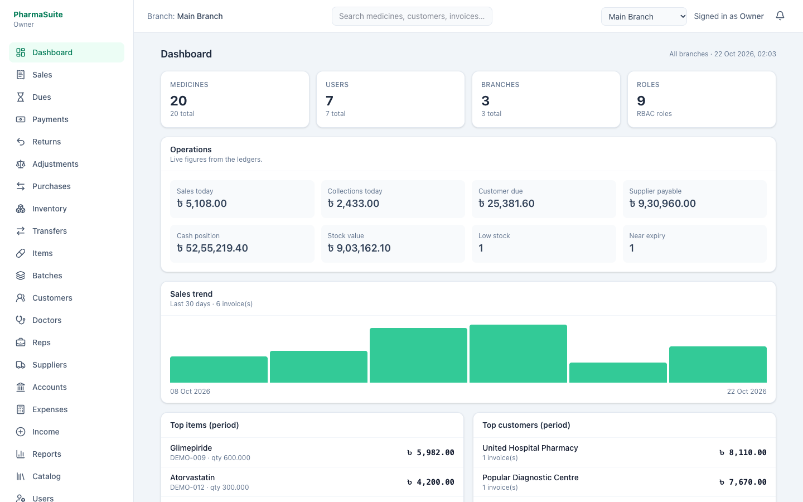

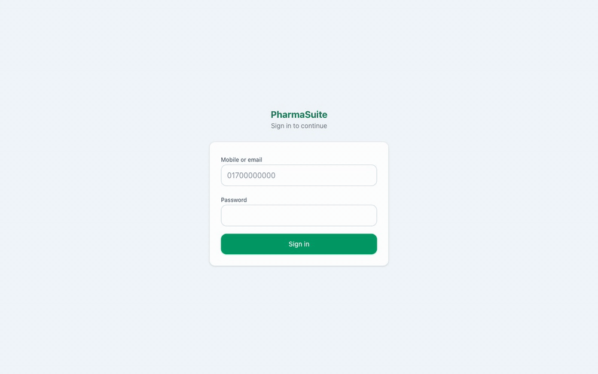

---

## The problem

A distributor with three branches and a few thousand SKUs cannot run on
spreadsheets. Batch numbers and expiry dates get lost between the warehouse and
the ledger; a pharmacy's credit limit is only known after a salesperson calls the
office; and month-end reconciliation means retyping invoices into a second sheet.

The hard part is not storing products and orders. It is keeping **stock and money
consistent** when two operators confirm documents at the same time, and being able
to prove afterwards who changed what.

PharmaSuite addresses that with append-only ledgers, atomic document confirmation,
idempotency keys, and permission-gated overrides.

## What it does

- **Confirms documents atomically.** A sales invoice writes the stock ledger,
  customer ledger, totals, and audit entry in one transaction. Retries are safe:
  every mutating document carries an idempotency key.
- **Allocates stock by FEFO.** First-expiry-first-out batch selection, with
  permission-gated overrides and a recorded reason. Expired batches are never
  sellable.
- **Keeps balances derivable.** Inventory, customer, supplier, and cash balances
  come from append-only ledgers plus projection tables, with integrity commands
  that detect drift.
- **Enforces credit and role rules.** Credit limits, overdue blocks, price tiers,
  and 65 permissions across 9 branch-scoped roles.
- **Closes the money loop.** Receipts and allocations, cheque lifecycle, supplier
  payments, sales/purchase returns, expenses with approval thresholds, and fiscal
  period locking.
- **Runs the field force.** Doctors, chambers, visits, samples linked to inventory,
  representatives, and territories.
- **Leaves an audit trail.** Before/after snapshots, request ID, IP, and user agent.
- **Tracks sessions per device.** Every login is a revocable session; the Security
  screen lists devices and can revoke one or all other sessions.

## Screenshots

| Dashboard | Sales invoice |
|---|---|
|  | 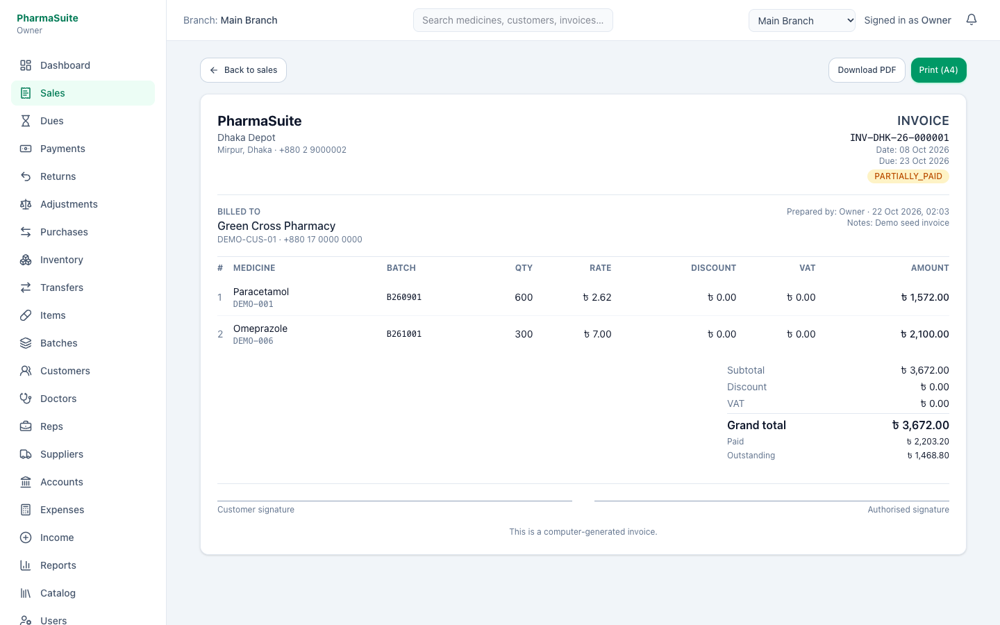 |

| Receivables and ageing | Inventory and batches |
|---|---|
| 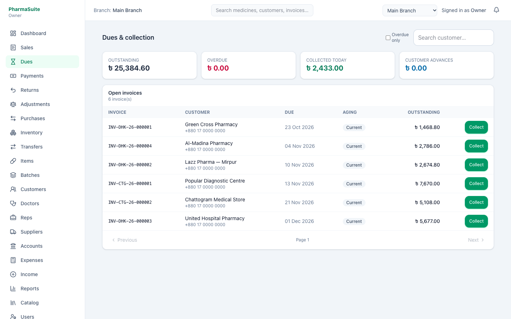 | 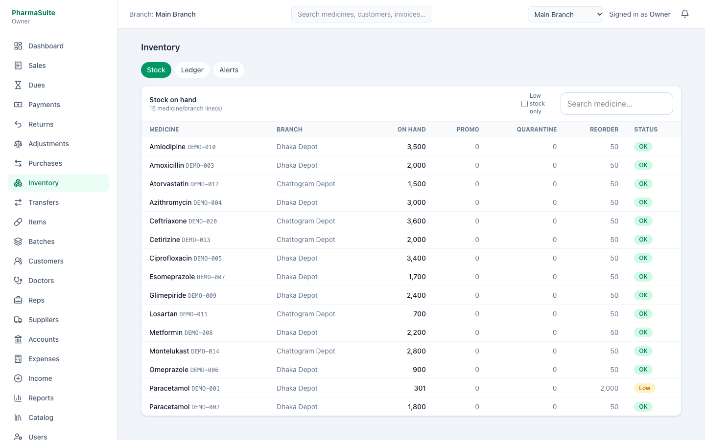 |

| Reports | Audit trail |
|---|---|
| 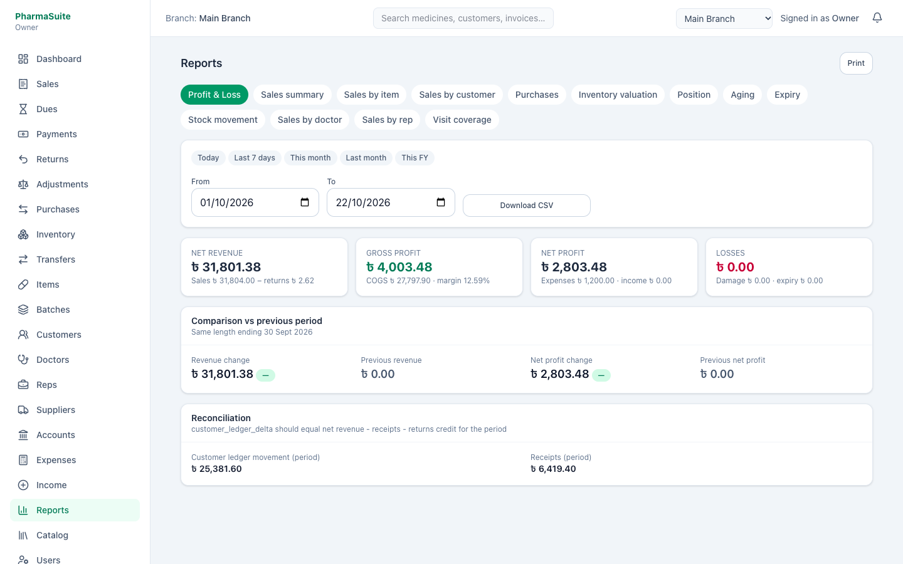 | 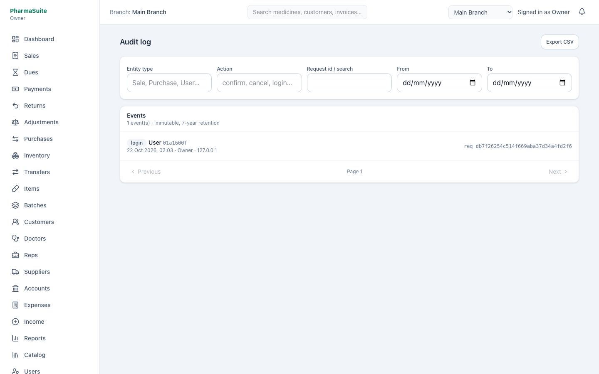 |

| Cheque lifecycle | Purchase history |
|---|---|
| 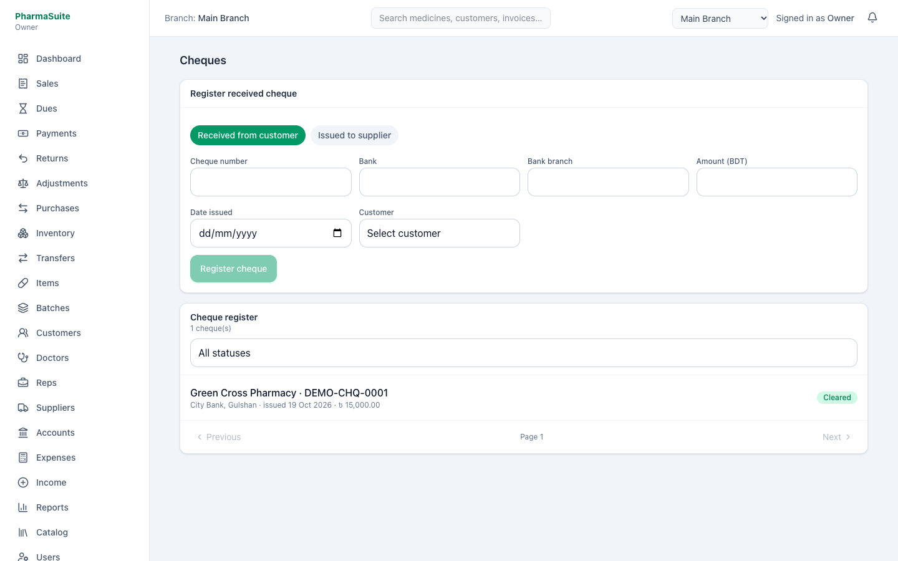 | 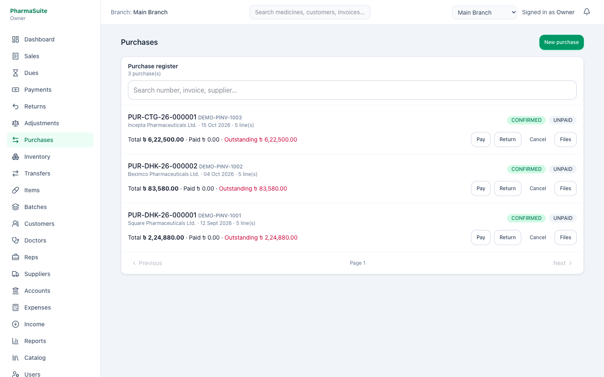 |

More in [`docs/screenshots/`](docs/screenshots/).

## Architecture

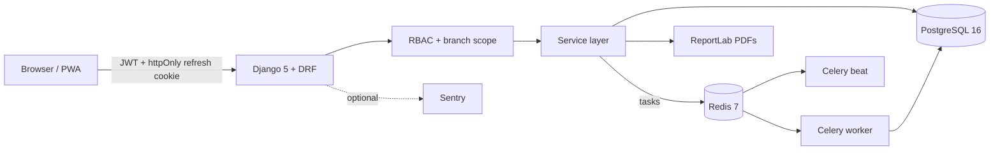

A modular monolith, not microservices: one team, one deploy unit, and transactional
consistency across stock, ledgers, and documents mattered more than independent
scaling. Business rules live in `apps/*/services.py`; views and serializers stay
thin.

> Redis is used as the Celery broker/result backend. **There is no cache layer in
> the request path** — the cache backend is configured but no code calls it.

## Tech stack

| Layer | Choice | Notes |
|---|---|---|
| API | Django 5, DRF | custom user model, service-layer business rules |
| Database | PostgreSQL 16 | row locking, `Decimal` money, projection tables |
| Async | Celery + Redis | stock/due/visit alerts, heartbeat |
| Auth | SimpleJWT + pyotp | 15-min access token, rotating 30-day refresh cookie, TOTP |
| Frontend | Next.js 15, React 19, TypeScript | App Router, TanStack Query, Tailwind 4, PWA |
| PDFs | ReportLab | invoices, purchase orders, receipts |
| Quality | pytest, Ruff, ESLint, Prettier, TypeScript strict, GitHub Actions | 162 tests, 77% line coverage |

## Quick start

**Prerequisites:** Docker, `uv`, Node 22+ (Node is only needed if you run the
frontend outside Docker).

```bash
git clone https://github.com/shamim565/PharmaSuite.git
cd PharmaSuite

make up          # postgres + redis + API + worker + beat + frontend
make seed-demo   # 3 branches, 20 medicines, purchases, invoices, payments
```

| Service | URL |
|---|---|
| Web app | http://localhost:3000 |
| API health | http://localhost:8000/api/v1/health/ |
| Deep health (DB check) | http://localhost:8000/api/v1/health/deep/ |
| Swagger UI | http://localhost:8000/api/v1/docs/ |
| OpenAPI schema | http://localhost:8000/api/v1/schema/ |

Demo logins (created by `seed-demo`, password `Demo@1234`):

| Role | Mobile |
|---|---|
| Owner | `01700000000` |
| Branch manager | `01700000011` |
| Accountant | `01700000012` |
| Sales operator | `01700000013` |
| Warehouse manager | `01700000014` |

`seed-demo` resets the owner password to the demo value. Pass
`--keep-owner-password` (`make seed-demo` calls the command directly) if you need
to preserve an existing password.

### Run without Docker

```bash
# services only
docker compose -f infra/docker-compose.yml up -d postgres redis

# API (terminal 1)
cd backend
cp .env.example .env
uv sync
uv run python manage.py migrate
uv run python manage.py seed_demo
uv run python manage.py runserver 8000

# frontend (terminal 2)
cd frontend
npm ci
npm run dev
```

The checked-in `.env.example` matches the Docker services (PostgreSQL on `5433`,
Redis on `6380`). For a native PostgreSQL/Redis install, adjust those values.

### Quick demo without PostgreSQL or Redis

`USE_SQLITE=True` switches the backend to SQLite, an in-memory cache, and eager
Celery tasks. It is intended for a fast local demo, not for production.

```bash
cd backend
USE_SQLITE=True uv run python manage.py migrate
USE_SQLITE=True uv run python manage.py seed_demo
USE_SQLITE=True uv run python manage.py runserver 8000
```


## API

Interactive documentation is served by drf-spectacular:

- Swagger UI: `http://localhost:8000/api/v1/docs/`
- OpenAPI 3.0 schema: `http://localhost:8000/api/v1/schema/` — **198 documented paths**

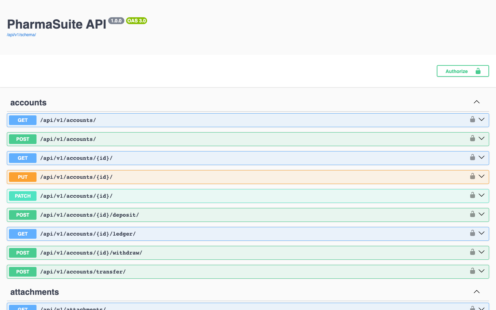

Authentication uses a short-lived bearer token. `POST /api/v1/auth/login/` returns
`access` and sets an httpOnly, SameSite=Lax refresh cookie scoped to
`/api/v1/auth/`. Send the access token on every request:

```bash
curl -s -X POST http://localhost:8000/api/v1/auth/login/ \
  -H 'Content-Type: application/json' \
  -d '{"identifier":"01700000000","password":"Demo@1234"}'

curl -s http://localhost:8000/api/v1/sales/ \
  -H "Authorization: Bearer <access>"
```

Errors use a stable envelope with a machine-readable `code`, a human `message`,
optional `field_errors`, and the `request_id` that correlates with server logs.

## Tests

```bash
make test          # host: uses backend/.env and the Docker database
make test-docker   # inside the api container
```

Current result:

```
162 passed
coverage: 77% line coverage
```

Coverage spans inventory posting and concurrency, sales controls, RBAC guards,
purchase flows, returns, PDFs, TOTP, and idempotency. Two concurrency tests assert
that duplicate idempotency keys post exactly once.

Integrity checks:

```bash
docker compose -f infra/docker-compose.yml exec web uv run python manage.py check_stock_integrity
docker compose -f infra/docker-compose.yml exec web uv run python manage.py check_ledger_integrity
```

## Engineering decisions

| Decision | Trade-off |
|---|---|
| Append-only ledgers + projection tables | Fast reads and verifiable balances; projections must be rebuilt/checked |
| `select_for_update` inside confirmation services | Correct under concurrency; serialises hot rows |
| Idempotency key on every mutating document | Safe retries; an extra unique index per document table |
| Modular monolith | Simple operations and cross-domain transactions; no independent scaling |
| Service layer for business rules | More files, but view-agnostic and testable |
| Data-driven RBAC (65 permissions, 9 roles) | Flexible and auditable; more complexity in the admin UI |
| `Decimal` for money and quantity | No float drift; slower than floats and requires quantisation discipline |
| No cache in the request path | Avoids stale balances; reports recompute on demand |

## Project layout

```
backend/
  apps/
    accounts/        users, roles, permissions, 2FA, login audit
    branches/        branch network and scope
    catalog/         generic, manufacturer, medicine, unit, batch
    inventory/       ledger, balances, transfers, adjustments
    purchases/       purchases, supplier payments, returns
    sales/           customers, invoices, returns, ledger
    payments/        receipts, allocations, cheques
    accounting/      accounts, expenses, income, period locking
    doctors/         doctors, chambers, visits, samples
    representatives/ territories, reps, assignments
    reports/         P&L, valuation, ageing, sales attribution
    dashboard/       role-aware summary widgets
    common/          numbering, periods, notifications, attachments, audit helpers
    audit/           audit log and retention purge
  config/            settings, URLs, Celery
  pyproject.toml     dependencies, ruff, pytest
frontend/
  src/app/(app)/     27 authenticated screens
  src/lib/api.ts     typed client with silent refresh
infra/               local Docker Compose
deploy/              VPS deploy/backup scripts and nginx snippet
docs/                architecture and reference deployment notes
```

## Known limitations

- Single-tenant deployment: one company per database.
- Reports aggregate on request; very large datasets will need materialised views.
- The frontend has no automated test suite yet; backend tests cover the API.
- `Redis` is not used as a cache — only as the Celery broker.
- The reference VPS deployment in `docs/deployment-vps.md` is not currently
  hosted; treat it as a runbook, not a live link.
- No horizontal scaling story for Celery yet.

## License

MIT © Shamim Azad. See [LICENSE](LICENSE).
