# Text-Based ERD

**Document ID:** DOC-ERD-001
**Parent:** `docs/03-domain-model.md`
**Entity definitions:** `docs/03-domain/entities-01…04`
**Conventions:** UUIDv7 PKs; FKs use `ON DELETE RESTRICT` unless noted; associative M:N tables carry payload fields; polymorphic references (`entity_type`,`entity_id`) are used only where a join table would fragment (RepresentativeAssignment, Attachment, AuditLog).

---

## 1. Mermaid ERD

```mermaid
erDiagram
  %% ===== Identity & Branch =====
  BRANCH ||--o{ USER : "default_branch"
  USER ||--o{ SESSION : has
  USER ||--o{ LOGIN_ATTEMPT : generates
  USER ||--o{ PASSWORD_HISTORY : keeps
  USER ||--o{ USER_ROLE : assigned
  ROLE ||--o{ USER_ROLE : contains
  USER ||--o{ USER_BRANCH : "access to"
  BRANCH ||--o{ USER_BRANCH : grants
  ROLE ||--o{ ROLE_PERMISSION : grants
  PERMISSION ||--o{ ROLE_PERMISSION : in

  %% ===== Catalog =====
  GENERIC ||--o{ MEDICINE : classifies
  MANUFACTURER ||--o{ MEDICINE : makes
  MEDICINE_CATEGORY ||--o{ MEDICINE : groups
  MEDICINE_CATEGORY ||--o{ MEDICINE_CATEGORY : "parent of"
  UNIT ||--o{ MEDICINE : "base unit"
  MEDICINE ||--o{ MEDICINE_UNIT_CONVERSION : has
  UNIT ||--o{ MEDICINE_UNIT_CONVERSION : for
  MEDICINE ||--o{ MEDICINE_BARCODE : identified

  %% ===== Inventory =====
  BRANCH ||--o{ MEDICINE_BATCH : stores
  MEDICINE ||--o{ MEDICINE_BATCH : batched
  SUPPLIER ||--o{ MEDICINE_BATCH : supplies
  MEDICINE_BATCH ||--o{ INVENTORY_TRANSACTION : moves
  MEDICINE_BATCH ||--|| STOCK_BALANCE : "caches"
  BRANCH ||--o{ STOCK_ADJUSTMENT : owns
  STOCK_ADJUSTMENT ||--o{ STOCK_ADJUSTMENT_ITEM : contains
  MEDICINE_BATCH ||--o{ STOCK_ADJUSTMENT_ITEM : targets
  BRANCH ||--o{ DOCUMENT_SEQUENCE : numbers

  %% ===== Procurement =====
  SUPPLIER ||--o{ SUPPLIER_LEDGER_ENTRY : ledger
  SUPPLIER ||--o{ PURCHASE : receives
  BRANCH ||--o{ PURCHASE : records
  PURCHASE ||--o{ PURCHASE_ITEM : contains
  PURCHASE_ITEM ||--o| MEDICINE_BATCH : "creates/merges"
  SUPPLIER ||--o{ SUPPLIER_PAYMENT : paid
  SUPPLIER_PAYMENT ||--o{ SUPPLIER_PAYMENT_ALLOCATION : splits
  PURCHASE ||--o{ SUPPLIER_PAYMENT_ALLOCATION : settled
  PURCHASE ||--o{ PURCHASE_RETURN : returned
  PURCHASE_RETURN ||--o{ PURCHASE_RETURN_ITEM : contains
  PURCHASE_ITEM ||--o{ PURCHASE_RETURN_ITEM : traces
  MEDICINE_BATCH ||--o{ PURCHASE_RETURN_ITEM : reduces

  %% ===== Sales & Payments =====
  CUSTOMER ||--o{ CUSTOMER_LEDGER_ENTRY : ledger
  CUSTOMER ||--o{ SALES_INVOICE : buys
  BRANCH ||--o{ SALES_INVOICE : issues
  REPRESENTATIVE ||--o{ SALES_INVOICE : "sales rep"
  DOCTOR ||--o{ SALES_INVOICE : "influences (optional)"
  SALES_INVOICE ||--o{ SALES_INVOICE_ITEM : contains
  MEDICINE_BATCH ||--o{ SALES_INVOICE_ITEM : "sold from"
  CUSTOMER ||--o{ PAYMENT : pays
  PAYMENT ||--o{ PAYMENT_METHOD_LINE : "split into"
  PAYMENT ||--o{ PAYMENT_ALLOCATION : allocates
  SALES_INVOICE ||--o{ PAYMENT_ALLOCATION : settled
  SALES_INVOICE ||--o{ SALES_RETURN : returned
  SALES_RETURN ||--o{ SALES_RETURN_ITEM : contains
  SALES_INVOICE_ITEM ||--o{ SALES_RETURN_ITEM : traces
  MEDICINE_BATCH ||--o{ SALES_RETURN_ITEM : restocks

  %% ===== CRM =====
  DOCTOR ||--o{ DOCTOR_CHAMBER : practices
  DOCTOR ||--o{ DOCTOR_MEDICINE : promoted
  MEDICINE ||--o{ DOCTOR_MEDICINE : target
  DOCTOR ||--o{ DOCTOR_VISIT : visited
  REPRESENTATIVE ||--o{ DOCTOR_VISIT : logs
  DOCTOR_VISIT ||--o{ DOCTOR_VISIT_SAMPLE : distributes
  MEDICINE_BATCH ||--o{ DOCTOR_VISIT_SAMPLE : "promo stock"
  TERRITORY ||--o{ TERRITORY : "parent of"
  TERRITORY ||--o{ CUSTOMER : covers
  TERRITORY ||--o{ DOCTOR : covers
  REPRESENTATIVE ||--o{ REPRESENTATIVE_ASSIGNMENT : assigned
  REPRESENTATIVE ||--o{ REPRESENTATIVE_TARGET : targets
  REPRESENTATIVE ||--o{ REPRESENTATIVE : "reports to"

  %% ===== Finance =====
  BRANCH ||--o{ FINANCIAL_ACCOUNT : owns
  FINANCIAL_ACCOUNT ||--o{ FINANCIAL_TRANSACTION : ledger
  EXPENSE_CATEGORY ||--o{ EXPENSE : classifies
  FINANCIAL_ACCOUNT ||--o{ EXPENSE : pays
  INCOME_CATEGORY ||--o{ INCOME : classifies
  FINANCIAL_ACCOUNT ||--o{ INCOME : receives

  %% ===== Platform =====
  USER ||--o{ NOTIFICATION : receives
  USER ||--o{ IDEMPOTENCY_KEY : owns
  USER ||--o{ REPORT_JOB : requests
```

---

## 2. Relationship Catalog

### 2.1 One-to-one (1:1)
| Parent | Child | Notes |
|---|---|---|
| MedicineBatch | StockBalance | One cache row per batch; maintained by service, never user-edited |
| Representative | User | Optional 1:1 link (`representative.user_id`) |
| Representative | RepresentativeTarget per period | One target row per rep per (year, month) |
| PurchaseItem | MedicineBatch | A purchase line creates/merges exactly one batch |

### 2.2 One-to-many (1:N) — FK on child
| Parent → Child | Cardinality | Notes |
|---|---|---|
| Branch → User (default), UserBranch, DocumentSequence, Purchase, SalesInvoice, StockAdjustment, FinancialAccount, Expense, Income, MedicineBatch | 1:N | `branch_id` on all operational tables (BR-BRANCH-001) |
| User → Session, LoginAttempt, PasswordHistory, UserRole, UserBranch, Notification, ReportJob, IdempotencyKey | 1:N | Cascade delete forbidden on history tables |
| Role → UserRole, RolePermission | 1:N | |
| Generic/Manufacturer/MedicineCategory/Unit → Medicine | 1:N | RESTRICT delete; deactivate instead |
| MedicineCategory → MedicineCategory | self 1:N | Hierarchy, acyclic |
| Territory → Territory, Customer, Doctor | 1:N/self | Hierarchy region→area→territory |
| Medicine → MedicineUnitConversion, MedicineBarcode, MedicineBatch, DoctorMedicine, DoctorVisitSample | 1:N | |
| MedicineBatch → InventoryTransaction, StockAdjustmentItem, PurchaseReturnItem, SalesInvoiceItem, SalesReturnItem, DoctorVisitSample | 1:N | Batch is the pivot of traceability |
| Supplier → SupplierLedgerEntry, Purchase, SupplierPayment, MedicineBatch | 1:N | |
| Purchase → PurchaseItem, SupplierPaymentAllocation, PurchaseReturn | 1:N | |
| PurchaseItem → PurchaseReturnItem | 1:N | Returnable = purchased − returned |
| SupplierPayment → SupplierPaymentAllocation | 1:N | Σ allocations ≤ payment |
| Customer → CustomerLedgerEntry, SalesInvoice, Payment, SalesReturn | 1:N | |
| SalesInvoice → SalesInvoiceItem, PaymentAllocation, SalesReturn | 1:N | |
| SalesInvoiceItem → SalesReturnItem | 1:N | Returnable = sold − returned |
| Payment → PaymentMethodLine, PaymentAllocation | 1:N | Σ method lines = payment amount |
| Doctor → DoctorChamber, DoctorMedicine, DoctorVisit | 1:N | Company-wide master (BR-CRM-001) |
| DoctorVisit → DoctorVisitSample | 1:N | |
| Representative → DoctorVisit, RepresentativeAssignment, RepresentativeTarget, Representative (self) | 1:N | |
| FinancialAccount → FinancialTransaction, Expense, Income | 1:N | |
| ExpenseCategory → Expense; IncomeCategory → Income | 1:N | Deactivate-only when used |
| DocumentSequence → (documents by convention) | 1 per (branch, doc_type, FY) | Sequence is referenced by `number`, not FK |
| User → AuditLog (actor) | 1:N optional | Null actor for SYSTEM |

### 2.3 Many-to-many (M:N) with join entities
| Left | Right | Join entity | Payload |
|---|---|---|---|
| User | Role | UserRole | assigned_at, assigned_by |
| User | Branch | UserBranch | is_default |
| Role | Permission | RolePermission | effect ALLOW/DENY |
| Doctor | Medicine | DoctorMedicine | priority, effective_from/to, strength_note |
| Representative | Customer/Doctor/Territory | RepresentativeAssignment | entity_type/id, effective range, is_primary (polymorphic M:N) |
| Payment | SalesInvoice | PaymentAllocation | amount (associative entity) |
| SupplierPayment | Purchase | SupplierPaymentAllocation | amount (associative entity) |
| DoctorVisit | MedicineBatch/Medicine | DoctorVisitSample | qty, unit_cost (associative entity) |
| (polymorphic) | — | Attachment | owner_type/owner_id |
| (polymorphic) | — | AuditLog | entity_type/entity_id |

### 2.4 Ledger ↔ document links
All four ledgers reference source documents by `(source_type, source_id, source_number)` (values, not FKs) to keep ledgers partitionable and immutable; document detail views query ledgers by this tuple (indexed).

---

## 3. Referential Rules & Cascades

| Rule | Policy |
|---|---|
| Financial/ledger/history data | `ON DELETE RESTRICT` always; no cascades |
| Join tables (UserRole, UserBranch, RolePermission) | `ON DELETE CASCADE` from parent (pure assignments) |
| Child document items (PurchaseItem, SalesInvoiceItem, …) | Cascade from parent **only while DRAFT**; confirmed documents are never deleted, so cascade paths are effectively unused |
| Masters (Medicine, Customer, Supplier, Doctor, Unit, …) | Soft delete (`deleted_at`); deletion blocked once referenced |
| Batch | Never deleted; DEPLETED status instead |
| IdempotencyKey, ReportJob, Notification | Transient; scheduled purge after expiry/retention |

---

## 4. Coverage Self-Check

| Module | Entities | In ERD |
|---|---|---|
| Identity (9) | User, Role, Permission, RolePermission, UserRole, UserBranch, Session, LoginAttempt, PasswordHistory | ✅ |
| Branch (1) | Branch | ✅ |
| Catalog (7) | Medicine, Generic, Manufacturer, MedicineCategory, Unit, MedicineUnitConversion, MedicineBarcode | ✅ |
| Inventory (6) | MedicineBatch, InventoryTransaction, StockBalance, StockAdjustment, StockAdjustmentItem, DocumentSequence | ✅ |
| Procurement (8) | Supplier, SupplierLedgerEntry, Purchase, PurchaseItem, SupplierPayment, SupplierPaymentAllocation, PurchaseReturn, PurchaseReturnItem | ✅ |
| Sales (6) + Payments (3) | Customer, CustomerLedgerEntry, SalesInvoice, SalesInvoiceItem, SalesReturn, SalesReturnItem, Payment, PaymentMethodLine, PaymentAllocation | ✅ |
| CRM (9) | Doctor, DoctorChamber, DoctorMedicine, DoctorVisit, DoctorVisitSample, Representative, RepresentativeAssignment, Territory, RepresentativeTarget | ✅ |
| Finance (7) | FinancialAccount, FinancialTransaction, Expense, ExpenseCategory, Income, IncomeCategory, FiscalPeriod | ✅ (FiscalPeriod standalone — no FK; period by date) |
| Platform/Reporting (7) | AuditLog, Notification, NotificationTemplate, Setting, IdempotencyKey, Attachment, ReportJob | ✅ |
| **Total** | **63** | **63/63** |

*FiscalPeriod intentionally has no FK: period locking matches on `business_date` ranges, which keeps documents partition-friendly.*
