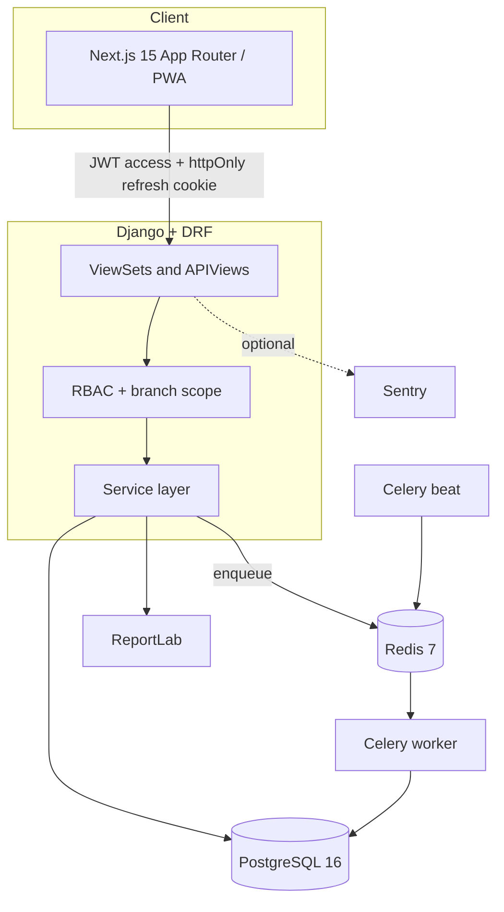
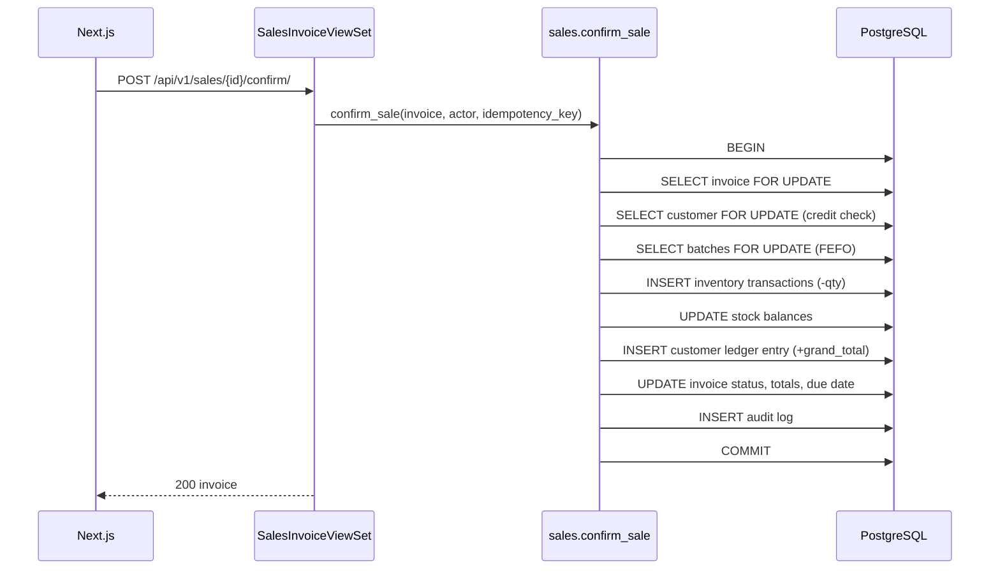

# Architecture

PharmaSuite is a modular monolith: a Django REST API, a PostgreSQL database, a
Celery worker/beat pair backed by Redis, and a Next.js client. This document
describes the components, the money/stock posting model, and the trade-offs behind
them.

## Components

| Component | Responsibility | Location |
|---|---|---|
| API | HTTP contracts, validation, pagination, filtering | `backend/apps/*/views.py`, `serializers.py` |
| Permissions | Declarative permission checks + branch scoping | `apps/common/permissions.py`, `apps/accounts/rbac.py` |
| Service layer | Multi-step business operations inside transactions | `apps/*/services.py` |
| Ledgers | Append-only stock, customer, supplier, and cash entries | `inventory`, `sales`, `suppliers`, `accounting` models |
| Projections | Cached balances derived from ledgers | `StockBalance`, `Customer.balance_cache`, `Supplier.balance_cache`, `FinancialAccount.balance_cache` |
| Async | Alerts and reminders off the request path | `apps/common/tasks.py`, `config/celery.py` |
| Numbering | Gapless, branch-scoped document numbers | `apps/common/numbering.py` |
| Periods | Fiscal-month locking (July–June) | `apps/common/periods.py` |
| Audit | Before/after snapshots with request correlation | `apps/audit/services.py` |

## Request lifecycle

1. DRF authenticates the JWT and resolves `request.user`.
2. The view declares `required_permissions`; `HasPermission` checks the user's
   effective permission set (superusers bypass).
3. Querysets are narrowed with `filter_by_branch_scope` unless the user has
   all-branch scope.
4. Mutating endpoints call a service function. The service owns the transaction,
   row locks, ledger postings, and audit entry.
5. Serializers never contain business rules.

## Invoice confirmation (the critical path)

Why this shape:

- **One transaction.** A partially posted invoice would leave stock and receivables
  inconsistent; there is no compensating job to repair that.
- **Pessimistic locking.** `select_for_update` on the invoice, customer, and batch
  rows serialises competing confirmations. The alternative — optimistic retries —
  would push conflict handling into every caller.
- **Idempotency key.** A unique key on the invoice/document means a retried request
  returns the original document instead of posting twice.
- **FEFO inside the lock.** Batch selection reads `StockBalance`, not the display
  cache on `MedicineBatch`, so allocation cannot use drifted data.
- **Ledger insert before projection update.** The append-only transaction is the
  source of truth; `StockBalance` is updated in the same transaction and can be
  verified later.

## Balance model

| Balance | Source of truth | Projection | Verification |
|---|---|---|---|
| Stock | `InventoryTransaction` | `StockBalance` + `MedicineBatch.qty_on_hand` | `manage.py check_stock_integrity` |
| Customer dues | `CustomerLedgerEntry` | `Customer.balance_cache` | `manage.py check_ledger_integrity` |
| Supplier payables | `SupplierLedgerEntry` | `Supplier.balance_cache` | `manage.py check_ledger_integrity` |
| Cash/bank | `FinancialTransaction` | `FinancialAccount.balance_cache` | `manage.py check_ledger_integrity` |

Reversals are new ledger entries that reference the original (`reverses_entry`),
never deletions. This preserves history and makes the audit trail meaningful.

## Concurrency and idempotency

- Every confirm/cancel/reverse service is wrapped in `@transaction.atomic`.
- Rows that can be contended (invoice, customer, batch, balance, account) are read
  with `select_for_update()`.
- Mutating documents expose a unique `idempotency_key`. The service returns the
  existing document when the key is reused.
- Inventory posting guards against negative balances inside the same lock.
- Two tests exercise concurrent posting with the same key:
  `apps/inventory/tests/test_posting.py`, `apps/inventory/tests/test_adjustments.py`.

## Authorization

- 65 permissions in a catalog, grouped by module and action (`apps/accounts/rbac.py`).
- 9 system roles: owner, super admin, admin, branch manager, accountant, sales
  operator, warehouse manager, sales rep, medical rep.
- `RolePermission.effect` supports explicit DENY.
- Roles carry a branch scope (`ALL` or `ASSIGNED`); `UserBranch` assigns branches.
- Sensitive permissions (cost visibility, overrides, refunds, period unlock) are
  flagged and used in views/services.
- Guards prevent privilege escalation when creating users or editing roles
  (`_ensure_actor_can_grant`, `_ensure_actor_can_edit_role`).

## Authentication

- Mobile number + password, Argon2 hashing.
- 15-minute access JWT; 30-day refresh token in an httpOnly, SameSite=Lax cookie
  scoped to `/api/v1/auth/`.
- Refresh rotation with blacklist-after-rotation.
- Login throttling, failed-attempt lockout, password history, forced password change.
- Optional TOTP 2FA with a two-step login challenge.
- Request IDs are attached to logs and audit entries.

## Asynchronous work

| Task | Schedule | Purpose |
|---|---|---|
| `heartbeat` | every 5 min | liveness / worker smoke test |
| `daily_stock_alerts` | 08:00 | low stock, near-expiry, expired summaries |
| `daily_due_alerts` | 09:00 | overdue receivables |
| `visit_reminders` | 18:00 | upcoming doctor visits |

Notifications are stored per user with category preferences. Redis is the broker
and result backend; it is **not** used as a cache.

## Failure modes

| Failure | Behaviour |
|---|---|
| Duplicate confirm request | Returns the existing document (idempotency key) |
| Insufficient stock | 409, transaction rolled back, no partial ledger rows |
| Credit limit exceeded | 409 unless the actor holds the override permission |
| Locked fiscal period | 409 unless the actor holds `PERIOD_OVERRIDE` |
| Concurrent same-key posting | One wins; the other returns the canonical rows |
| Projection drift | `check_stock_integrity` / `check_ledger_integrity` report it |
| Redis down | API still serves; async alerts stop |

## Known limitations

- Single-tenant: one company per database.
- Reports aggregate at request time; large datasets will need materialised views.
- `StockBalance` updates serialise per batch row; very hot SKUs will contend.
- No read replicas or connection-pool tuning documented yet.
- The frontend has no automated tests; API behaviour is covered by 137 backend tests.
- The reference VPS deployment (`docs/deployment-vps.md`) is not currently hosted.
